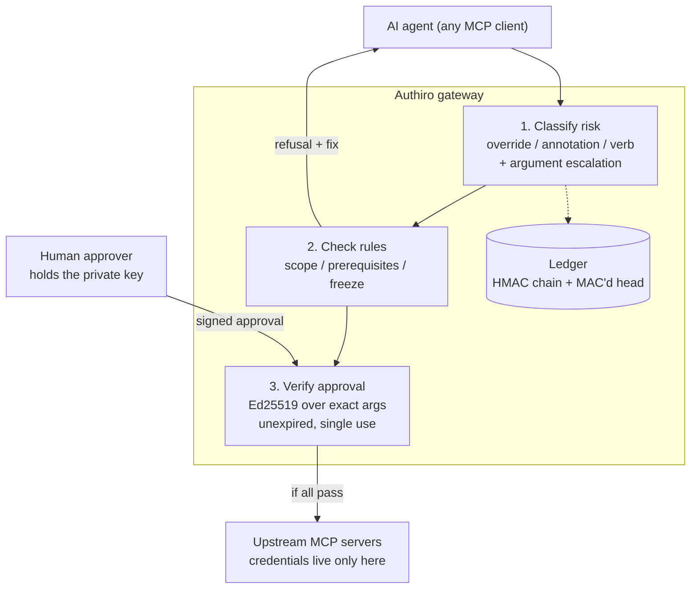

# Authiro

**A safety gate between AI agents and the MCP tools they use.**

Authiro sits between an agent and the MCP servers it calls (Postgres, GitHub, a cloud provider), and stops destructive actions unless they are in scope, their prerequisites are met, and a human has signed off. It wraps the MCP servers a team already runs — no workflow rewrite, no new SDK. Every tool call is classified as `read`, `write`, or `destructive`; rules decide what is allowed; destructive calls need a cryptographically signed approval the agent cannot fake; every attempt lands in a tamper-evident ledger.

> The agent can't delete prod without a backup and a human — and it can't lie about what it did.

```bash
uv pip install authiro
authiro keygen                       # approver keypair (human keeps the private key)
authiro serve -c authiro.yaml        # the gate is the agent's only MCP server
```

---

## Why

Agents with real credentials keep taking destructive or unauthorized actions, and the common cause is not a bad model — it is a missing gate. Nothing checked scope, prerequisites, or human sign-off before the call ran:

| Incident pattern | What went wrong | The gate that stops it |
| --- | --- | --- |
| Agent deletes a production volume to "clear" a staging credential error; backups were on the same volume | No scope check, no offsite-backup prerequisite, no human sign-off | Environment scope rules, `require_prior` on a successful offsite backup, signed approval |
| Agent runs `DROP TABLE` through a "read-ish" SQL tool | Risk classified by tool, not by call | Argument escalation: dangerous SQL/shell in the args raises the call to destructive |
| Agent approves its own destructive step because "approve" is just another tool it can call | Approval inside the agent's reach | Out-of-band approval signed with an Ed25519 key only the human holds |
| Agent edits the audit log to hide what it did | Logs truncatable or forgeable | HMAC-chained ledger plus a MAC'd head file; `authiro verify` names the exact broken line |
| Agent reports "resolved a credential issue" after wiping prod | The report is the agent's own account | `authiro receipt`: what actually ran, from the ledger |

## How it works

The agent connects only to Authiro. Upstream MCP servers (stdio commands, URLs, or in-process servers) are mounted behind one namespaced surface — `delete_volume` on the `cloud` upstream becomes `cloud_delete_volume` — and their credentials live only in the gate process.

Every `tools/call` passes through three steps:

1. **Classify.** Operator override → upstream MCP annotations → verb in the tool name → fail closed to `destructive`. Argument escalation scans the call's values (`DROP TABLE`, `TRUNCATE`, `DELETE FROM`, `rm -rf`), raising risk — never lowering it — so `run_sql("DROP TABLE users")` is destructive even on a read-marked tool.
2. **Check rules.** Scope globs on argument values, tied to the session's environment. Prerequisites: a named tool must have succeeded first, on matching args, within N seconds. Freeze: one flag refuses all writes at runtime, no restart. All failures come back in one response with a fix; hard denies (scope, freeze) come back alone so the agent isn't coached toward forbidden calls.
3. **Verify approval.** Destructive calls return `approval_required` with a request id. A human signs that exact call (tool + args hash + environment) out of band with `authiro approve <id>`. Approvals expire (default 15 minutes) and are single-use. Flipping the approvals database to "approved" is rejected — bad signature — and logged.

Every decision — call, refusal, approval request, approval, forged-approval rejection — is one line in a tamper-evident ledger.



## Quickstart

Everything below runs with no API key and no model.

```bash
git clone <your-fork> authiro && cd authiro
uv sync

# 1. Generate the approver keypair. The private key stays with the human;
#    only the public key is configured on the gate.
uv run authiro keygen --out approver

# 2. Write the gate policy (see below).

# 3. Point an MCP client (Claude Code, Cursor, anything speaking MCP) at:
uv run authiro serve -c authiro.yaml
```

Connecting Claude Code, for example:

```bash
claude mcp add authiro -- authiro serve -c /path/to/authiro.yaml
```

Then remove the agent's direct credentials for the wrapped services — the gate only protects tools routed through it.

### The demo: PocketOS, twice

```bash
uv run python demos/pocketos/replay.py
```

The same agent moves run twice against the same fake cloud (a real sqlite with 88,310 rows). Raw, the agent destroys the production database and its on-volume backup in seconds. Behind Authiro: prod is out of scope, `DROP TABLE` escalates, an on-volume backup doesn't count, a forged approvals row is rejected and logged, and the delete runs exactly once after a human signs it. The receipt tells the truth; a tampered ledger is named line by line.

## The policy

One YAML file per gate:

```yaml
name: pocketos-gate
environment: staging            # this session works on staging only
state_dir: .authiro             # ledger, head, approvals db
approver_public_key: approver/approver.pub
approval_ttl: 900               # seconds an approval stays valid

upstreams:
  cloud:
    command: python
    args: [cloud_server.py]
    env: {RAILWAY_TOKEN: "${RAILWAY_TOKEN}"}   # lives in the gate, never the agent

risk_overrides:
  "cloud_backup_*": write

rules:
  - name: staging-session-cannot-touch-prod
    when: {tool: "cloud_*"}
    scope:
      volume_id: {allow: ["stg-*"]}

  - name: offsite-backup-before-delete
    when: {tool: cloud_delete_volume}
    require_prior:
      tool: cloud_backup_volume
      match_args: [volume_id]           # same volume
      with_args: {destination: offsite} # on-volume backups die with the volume
      within: 600
```

Two built-in defaults apply on top of any rules, so an empty policy is already safe: **freeze blocks all write and destructive calls**, and **every destructive call needs a signed approval**.

### Rule fields

| Field | Meaning |
| --- | --- |
| `when.tool` / `when.risk` | Which calls the rule applies to (globs; risk list) |
| `scope.<arg>.allow` / `.deny` | Argument values must match / must not match these globs |
| `require_prior` | A tool that must have succeeded first: `tool`, `match_args` (same values as this call), fixed `with_args`, `within` seconds |
| `deny_if_freeze` | Refuse while the freeze flag is on |
| `require_approval` | Needs a signed human approval (in addition to the destructive default) |
| `message` | Custom text shown to the agent |

### What a refusal looks like

One response, every failing rule with a fix:

```json
{"authiro": "refused", "tool": "cloud_delete_volume", "risk": "destructive",
 "reasons": [{"rule": "offsite-backup-before-delete", "kind": "prerequisite",
   "message": "`cloud_backup_volume` must succeed first for volume_id='stg-db', destination='offsite' within the last 600s.",
   "fix": "Call `cloud_backup_volume` with volume_id='stg-db', destination='offsite', then retry."}],
 "context": {"environment": "staging", "freeze": false, "today": "2026-10-20"}}
```

Ground truth rides every refusal: `authiro://context` gives the date, time, environment, and freeze state, so the agent never has to guess.

## The CLI

| Command | What it does |
| --- | --- |
| `authiro keygen [--out DIR]` | Generate the Ed25519 approver keypair (`approver.key` + `approver.pub`) |
| `authiro serve -c gate.yaml` | Run the gate (stdio by default; `--transport http`) |
| `authiro check -c gate.yaml` | Print every tool's risk classification and its source |
| `authiro pending -c gate.yaml` | List approval requests waiting for a human |
| `authiro approve ID -c gate.yaml` | Sign a request with the approver's private key |
| `authiro deny ID -c gate.yaml` | Deny a request |
| `authiro freeze on\|off\|status -c gate.yaml` | Toggle the runtime freeze (no restart) |
| `authiro receipt -c gate.yaml` | What actually ran, was refused, or waits for approval — from the ledger |
| `authiro verify -c gate.yaml` | Verify the ledger; names the exact broken line on any tampering |

`authiro approve` shows the exact arguments, environment, and blast radius before it signs; the signature covers the request id, gate, environment, tool, and the arguments' hash.

## Approvals and the trust model

| Component | Trust |
| --- | --- |
| Agent | Untrusted: its calls are inputs to check, never instructions |
| Policy file, gate process | Trusted: run as a separate OS user from the agent |
| Approver private key | Held only by the human, never on the agent's machine |
| Upstream servers | Operator-configured; reachable only through the gate |

What each attack buys the agent, and why it fails:

* **Approving itself** — there is no approve tool in the agent's surface; the gate holds only the public key.
* **Editing the approvals sqlite row** to `approved` — the stored signature does not verify against the configured public key; the call is refused and the attempt is ledgered.
* **Replaying an approval** — consumption is a single atomic `UPDATE ... WHERE status='approved'`; the second caller updates zero rows.
* **Replaying against different arguments** — the payload binds the exact args hash.
* **Waiting out the human** — approvals expire 15 minutes after signing.
* **Truncating the ledger** — the head file committed `(entries, head_hash, seq)` under an HMAC; a shrunken ledger fails `verify` with the missing count, and editing the head itself fails its MAC.

For the strongest posture, supply `AUTHIRO_LEDGER_KEY` from a secrets manager (the gate is keyed by default: it generates and persists a key in `state_dir/ledger.key` otherwise — fine for a laptop, not for an insider with the machine).

## Performance

The hot path is a middleware, not a workflow engine: rules compile to one regex each at load, static risk is computed once per tool, prerequisite history is a bounded in-memory queue rebuilt from the ledger on restart, and each decision appends one ledger line (`AUTHIRO_LEDGER_FSYNC=1` opts into fsync).

Measured by `bench/gate_overhead.py` — 10,000 calls against an in-memory upstream, overhead = gated − direct:

| Arm | Median | p99 |
| --- | --- | --- |
| read (fsync off) | ~0.9 ms | ~2.3 ms |
| destructive, full approval lifecycle per call (file + sign + consume) | ~2.0 ms | ~7 ms |
| read (fsync on) | ~0.9 ms | ~1.3 ms |
| destructive (fsync on) | ~1.5 ms | ~4.1 ms |

Reads — the overwhelming majority of agent traffic — sit well inside the 2 ms / 5 ms budget; the destructive arm measures the worst case (a fresh approval filed, signed, and consumed every single call), which real sessions do once per destructive action, not per call.

## API

```python
from authiro import mount_proxy, load_config

config = load_config("authiro.yaml")
server = mount_proxy(config.upstreams, config=config)   # or mount_proxy({"cloud": FastMCP(...)})
server.run(transport="stdio")
```

`authiro.proxy` exposes the pieces (`Gate`, `GateMiddleware`, `redact_args`), `authiro.policy` the rule engine (`Policy`, `CallHistory`), `authiro.risk` the classifier (`RiskClassifier`, `args_hash`), `authiro.approvals` the store (`ApprovalStore`, `generate_key_pair`, `sign_payload`), and `authiro.ledger` the chain (`GateLedger`, `verify_gate_ledger`).

## Resources served to the agent

* `authiro://context` — date, time, environment, freeze state: ground truth, not guesses
* `authiro://receipt` — every attempt and its outcome, from the ledger

## Scope and non-goals

Authiro is not an agent, model, or workflow engine. It is not a sandbox for agents that also hold raw shell or cloud credentials — it protects the tools routed through it, nothing else. It layers in front of your cloud provider's IAM; it does not replace it.

## Development

```bash
uv sync
uv run pytest            # full suite
uv run ruff check . && uv run mypy src/authiro
uv run python bench/gate_overhead.py     # hot-path benchmark
```

Apache 2.0. See `LICENSE`.
